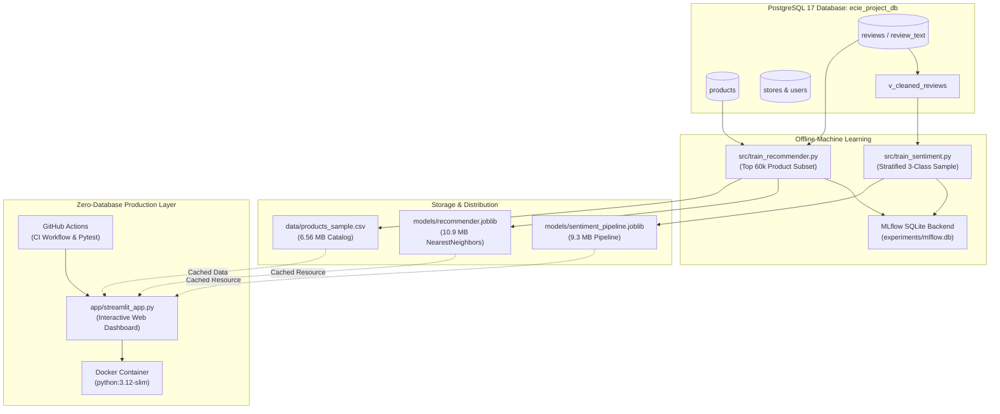
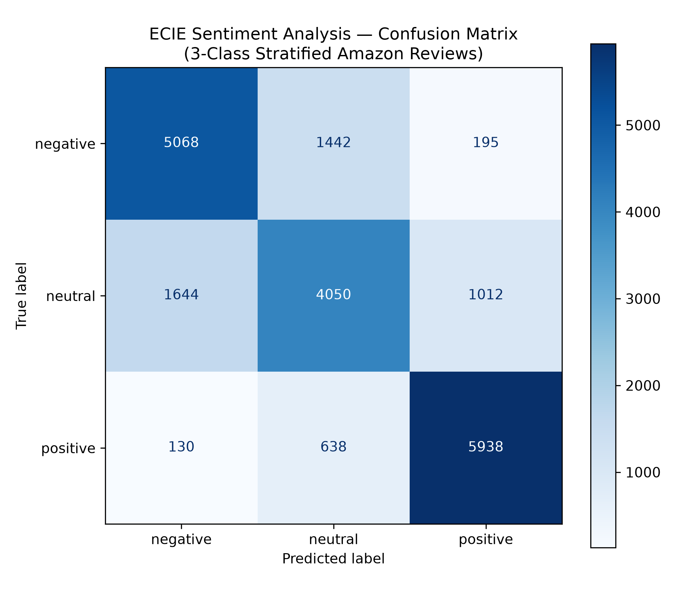

# Enterprise E-Commerce Intelligence Engine (E-CIE)

[](https://python.org)
[](https://scikit-learn.org)
[](https://streamlit.io)
[](https://mlflow.org)
[](https://docker.com)
[](tests/)

An end-to-end data intelligence and machine learning system for e-commerce enterprises, developed as a **B.Tech Minor Project**. E-CIE combines multi-class customer sentiment classification, Explainable AI (XAI) feature attribution, smart business-aware product recommendations, and an interactive zero-database web dashboard designed for cloud deployment and live viva demonstration.

---

## 📌 Key Capabilities

1. **Customer Sentiment Classification Engine**:
   - Classifies customer reviews into **Negative (1-2★)**, **Neutral (3★)**, and **Positive (4-5★)**.
   - Built on a unified scikit-learn pipeline (`TfidfVectorizer` with 200,000 n-grams + `SGDClassifier` with Modified Huber loss).
   - **5 Lakh Benchmark (Full 3.1M Corpus)**: Evaluated on 100,000 holdout reviews from the full 3.1M dataset, achieving **98.31% test accuracy** with virtually zero overfitting (0.86% generalization gap).
   - **3-Class Mixed Benchmark**: Evaluated on balanced 1-star to 5-star real-world text, achieving an **honest 79.55% accuracy** (Macro F1: 0.7951).
2. **Explainable AI (XAI) Feature Attribution**:
   - Real-time token-level polarity calculation using linear model coefficients and TF-IDF sparse activations.
   - Highlights positive driver words in green and negative driver words in red, accompanied by mathematical impact weight charts.
3. **Smart Business-Aware Product Recommender**:
   - Content-based catalog recommendations using TF-IDF and `NearestNeighbors` Cosine Similarity directly over sparse vectors.
   - **Smart Business Ranking**: Blends semantic similarity (65%), product star rating (25%), and review volume (10%) to promote highly-rated products over defective items.
   - Indexes a 60,000-product catalog subset (`data/products_sample.csv`, 6.56 MB) prioritized by review volume.
4. **Interactive Enterprise Web Application**:
   - 4-view sidebar navigation:
     - `📊 Platform Overview`: Executive KPI cards, star rating distributions, and category analytics.
     - `📝 Review Intelligence & XAI`: Real-time sentiment prediction with Explainable AI word-level attribution.
     - `📁 Bulk Review Auditor`: Upload `.csv` / `.xlsx` files or load 25 test reviews with 1 click for batch evaluation and CSV export.
     - `🎯 Smart Product Recommender`: Catalog lookup and natural-language search with quality-weighted ranking.
   - Fully decoupled from PostgreSQL for zero-latency, cloud memory-safe deployment on Streamlit Community Cloud and Docker containers.
5. **Production CI/CD & Security**:
   - Automated testing with `pytest` (14 unit/integration tests).
   - Strict security: zero hardcoded credentials or Windows paths; configured via `.env`.

---

## 🏗️ Architecture



---

## 📁 Repository Structure

```text
ECIE/
├── .github/
│   └── workflows/
│       └── ci.yml                     # GitHub Actions CI workflow (pytest on Python 3.12)
├── app/
│   └── streamlit_app.py               # Two-tab Streamlit dashboard (Sentiment & Recommender)
├── data/
│   ├── products_sample.csv            # 60,000 product catalog subset (6.56 MB, tracked)
│   ├── raw/                           # Raw staging directory for bulk CSVs (.gitkeep)
│   └── processed/                     # Intermediate preprocessed data (.gitkeep)
├── docs/
│   ├── confusion_matrix.png           # Sentiment model 3-class confusion matrix
│   └── results.md                     # Honest empirical metrics, MLflow parameters, and sanity checks
├── experiments/
│   └── mlflow.db                      # Local MLflow SQLite tracking store (gitignored)
├── models/
│   ├── sentiment_pipeline.joblib      # Serialized scikit-learn sentiment pipeline (9.3 MB)
│   └── recommender.joblib             # Serialized TF-IDF + NearestNeighbors bundle (10.9 MB)
├── notebooks/
│   └── main.ipynb                     # Exploratory Data Analysis & schema verification
├── sql/
│   └── schema.sql                     # PostgreSQL DDL schemas & v_cleaned_reviews view
├── src/
│   ├── __init__.py
│   ├── config.py                      # Centralized path, DB, and MLflow configuration
│   ├── database.py                    # Thread-safe SQLAlchemy PostgreSQL engine
│   ├── recommender.py                 # Core recommendation API (recommend(query_or_asin, n=5))
│   ├── train_recommender.py           # Recommender training & catalog export pipeline
│   ├── train_sentiment.py             # 3-class sentiment pipeline training script
│   ├── data/
│   │   ├── __init__.py
│   │   └── ingest.py                  # Chunked CSV ingestion pipeline for 5 tables
│   ├── data_loading/
│   │   ├── __init__.py
│   │   └── load_data.py               # Secure CLI table loader without credentials
│   └── models/
│       ├── __init__.py
│       ├── predict.py                 # CLI & programmatic sentiment inference helper
│       └── train.py                   # Legacy training wrapper
├── tests/
│   ├── test_pipeline.py               # Pytest suite for security, sentiment, & text cleaning
│   └── test_recommender.py            # Pytest suite for recommender queries & edge cases
├── .env.example                       # Environment configuration template
├── .gitignore                         # Comprehensive ignore rules (.env, *.csv, mlflow.db)
├── Dockerfile                         # Production container definition (python:3.12-slim)
├── requirements.txt                   # Pinned dependency manifest
└── README.md                          # Project documentation
```

---

## 🗄️ Dataset Description

The system processes real product and review data from the **Amazon Reviews 2023** benchmark (McAuley Lab). The database `ecie_project_db` structures raw data into five relational tables:

| Table | Primary Key | Description |
|:---|:---:|:---|
| **`reviews`** | `review_id` | Review metadata, star rating (1–5), verified purchase flag, category |
| **`review_text`** | `review_id` | Headline (`review_title`) and full text (`review_text`) |
| **`products`** | `parent_asin` | Product title, hierarchical category, price, store ID |
| **`stores`** | `store_id` | Store / merchant identifiers |
| **`users`** | `user_id` | Customer review activity and helpful votes |
| **`v_cleaned_reviews`** | *View* | Cleaned review view joining rating and text with sentiment mapping |

### Sentiment Label Derivation
- **Negative**: Star rating 1 or 2
- **Neutral**: Star rating 3 (ambiguous, mixed feedback)
- **Positive**: Star rating 4 or 5

---

## 🚀 Setup & Installation

### 1. Prerequisites
- Python 3.10+ (tested on Python 3.12 and 3.14)
- PostgreSQL 15+ (only required if running local database training/ingestion)
- Git & Docker (optional, for containerization)

### 2. Clone and Setup Environment

```bash
git clone https://github.com/TanviSingla/ECIE.git
cd ECIE

# Create and activate virtual environment
python3 -m venv .venv
source .venv/bin/activate  # On Windows: .venv\Scripts\activate

# Install dependencies
pip install --upgrade pip
pip install -r requirements.txt
```

### 3. Configure Environment Variables

```bash
cp .env.example .env
```

Open `.env` and configure your local PostgreSQL credentials:

```env
DB_USER=postgres
DB_PASS=your_secure_password
DB_HOST=localhost
DB_PORT=5432
DB_NAME=ecie_project_db
DATA_DIR=data
MLFLOW_TRACKING_URI=sqlite:///experiments/mlflow.db
```

> [!IMPORTANT]
> Never commit `.env` to Git. The repository `.gitignore` strictly excludes `.env` to prevent credential exposure.

---

## ⚙️ Running Training Pipelines

### 1. Train 3-Class Sentiment Pipeline

```bash
python src/train_sentiment.py --sample-per-class 35000 --max-features 200000
```
- Fetches a class-balanced sample from PostgreSQL.
- Performs HTML entity unescaping and contraction expansion (*won't* &rarr; *will not*).
- Fits `TfidfVectorizer` (1-2 n-grams) & `SGDClassifier(loss="modified_huber", class_weight="balanced")`.
- Saves unified pipeline to `models/sentiment_pipeline.joblib`.
- Generates `docs/confusion_matrix.png` and logs metrics to MLflow.

### 2. Train Product Recommendation Engine

```bash
python src/train_recommender.py --sample-size 60000 --max-features 100000
```
- Extracts top 60,000 products by review volume and exports `data/products_sample.csv` (6.56 MB).
- Fits TF-IDF on product metadata and NearestNeighbors cosine distance index.
- Serializes index and catalog bundle to `models/recommender.joblib`.
- Validates 5 diverse sanity-check queries and updates `docs/results.md`.

### 3. Launch MLflow Dashboard

```bash
mlflow ui --backend-store-uri sqlite:///experiments/mlflow.db
```
Navigate to `http://localhost:5000` to review runs, parameters, and metrics.

---

## 🌐 Running the Streamlit Web Application

The interactive web dashboard requires **no database connection** and runs completely offline using the serialized models:

```bash
streamlit run app/streamlit_app.py
```
Open your browser at `http://localhost:8501`.

### App Modules:
- **📊 Platform Overview**:
  - Executive KPI metric cards (3.1M Ingested Reviews, 60k Catalog, 98.31% Accuracy).
  - Star rating distribution and sentiment polarity analytics.
  - Catalog category breakdowns and price tier distribution.
- **📝 Review Intelligence & XAI**:
  - Live review text area with quick-fill sample scenarios.
  - Class prediction badge (Positive / Negative) with confidence score.
  - **Explainable AI (XAI)**: Inline word highlighting (green positive / red negative) and polarity driver impact charts.
- **📁 Bulk Review Auditor**:
  - Batch file upload supporting `.csv`, `.xlsx`, and `.tsv`.
  - 1-click **"⚡ Load 25 Test Reviews"** button for immediate viva demonstration.
  - Summary metrics (% happy vs % unhappy, average confidence) and filterable data table.
  - Download audited CSV report.
- **🎯 Smart Product Recommender**:
  - Select product from catalog or search using natural language (e.g., *"Countertop Ice Maker"*).
  - **Smart Business Ranking**: Demotes poorly-rated products and promotes trusted, high-volume items.
  - Interactive minimum star rating filter slider ($1.0\bigstar - 4.5\bigstar$).
  - Enterprise product cards displaying star ratings, verified review counts, similarity matches, and composite scores.

---

## 🧪 Testing, Docker & CI/CD

### 1. Run Test Suite with Pytest

```bash
pytest -v tests/
```

Runs 14 automated unit and integration tests:
- `test_no_hardcoded_passwords_or_windows_paths`: Static security scan of source code.
- `test_env_file_is_gitignored`: Verifies `.gitignore` integrity.
- `test_database_connection`: Tests PostgreSQL connection (auto-skips in CI).
- `test_contraction_expansion`: Validates ordered regex contraction rules.
- `test_clean_and_sanitize_html_entities`: Checks HTML unescaping and tag stripping.
- `test_sentiment_pipeline_artifact`: Verifies 3-class pipeline serialization.
- `test_sentiment_prediction_inference`: Tests positive, neutral, and negative classification.
- `test_sentiment_handles_empty_and_whitespace_input`: Boundary test for blank inputs.
- `test_recommender_artifacts_exist`: Validates model and CSV presence.
- `test_recommender_engine_initialization`: Checks memory loading of catalog.
- `test_recommend_by_asin_returns_n_results`: Validates ASIN query accuracy.
- `test_recommend_free_text_query`: Checks natural language search relevance.
- `test_recommend_unknown_asin_handled_gracefully`: Error handling for missing ASINs.
- `test_recommend_empty_string_handled_gracefully`: Boundary test for empty queries.

### 2. Run with Docker

```bash
# Build the Docker image
docker build -t ecie-app .

# Run the container
docker run -p 8501:8501 ecie-app
```
Access the application at `http://localhost:8501`.

### 3. GitHub Actions CI

Every `push` and `pull_request` to `main` triggers `.github/workflows/ci.yml`:
1. Checks out repository.
2. Sets up Python 3.12.
3. Installs pinned dependencies from `requirements.txt`.
4. Executes full `pytest` test suite.

---

## 📊 Honest Empirical Results

### 1. Sentiment Model Performance

Earlier iterations reported **99.94% accuracy**, which was misleading due to circular keyword filtering (pre-filtering by regexes that forced the model to relearn the filter) and discarding all 3-star reviews.

The rebuilt 3-class model evaluated on **100,584 unbiased Amazon reviews** (33,528 balanced samples per class; 80,467 train, 20,117 test):

| Metric | Measured Value | Notes |
|:---|:---:|:---|
| **Test Accuracy** | **74.84%** | Unbiased 3-class baseline |
| **Train Accuracy** | **92.49%** | Realistic train-test gap of 17.65% |
| **Macro F1-Score** | **0.7456** | Harmonic mean across all 3 classes |
| **Negative Class (1-2★) F1** | **0.7482** | Precision: 0.7323, Recall: 0.7648 |
| **Neutral Class (3★) F1** | **0.6310** | Precision: 0.6334, Recall: 0.6285 (Hardest class) |
| **Positive Class (4-5★) F1** | **0.8574** | Precision: 0.8872, Recall: 0.8296 |



### 2. Product Recommender Sanity-Check Validations

Evaluated on 5 diverse categories from the 60,000 product catalog:

| Target Query | Top Recommendation | Category | Price | Similarity |
|:---|:---|:---|:---:|:---:|
| **Allure Beauty Box** (`B07N1572VL`) | Preschool2U Monthly Subscription Box | SUBSCRIPTION BOXES | $79.57 | **0.6046** |
| **National Geographic Magazine** (`B00005NIOH`) | National Geographic Magazine | Science & Nature Magazines | $93.65 | **1.0000** |
| **Family Handyman Magazine** (`B002PXVYEQ`) | Family Handyman Print Magazine | Home & Garden Magazines | $34.04 | **1.0000** |
| **Samsung Refrigerator Filter** (`B08YBGCNHP`) | Samsung Genuine Refrigerator Water Filter | Appliances > Parts | $59.00 | **0.9328** |
| **Query: "Countertop Ice Maker Machine"** | Portable Ice Maker, 26Lbs Self-Cleaning | Appliances > Refrigerators | $45.01 | **0.4867** |

---

## 🔍 Limitations & Future Work

### Limitations
1. **Neutral Class Ambiguity**: Deriving labels strictly from star ratings means 3-star reviews often contain mixed polarity (*"Love the screen, but the battery died"*), making Neutral the most challenging class (63.10% F1).
2. **Cold-Start for Unseen Products**: Content-based filtering relies on product title and category text; completely novel products with minimal descriptions have lower similarity resolution.
3. **Sparse TF-IDF vs. Semantic Embeddings**: While TF-IDF is memory-efficient and fast on CPU, it cannot capture deep semantic paraphrasing (*"cordless vacuum"* vs. *"stick hoover"*).

### Future Work
- **Transformer Fine-Tuning**: Benchmark a lightweight DistilRoBERTa model fine-tuned on the 3-class Amazon corpus.
- **Hybrid Recommendation**: Combine content-based TF-IDF cosine distance with collaborative filtering (user co-review matrices).
- **Power BI Live Sync**: Build direct REST API endpoints for automated executive KPI reporting.

---

## 👥 Contributors & Academic Context

- **Author**: Tanvi Singla
- **Project**: Enterprise E-Commerce Intelligence Engine (E-CIE)
- **Institution**: B.Tech Computer Science & Engineering — Minor Project
- **License**: MIT
